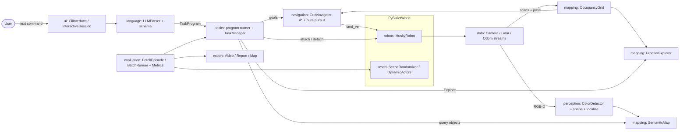

# husky-language-fetch

A language-commanded fetch robot. Type *"bring the red box to the dock"* (or
*"grab the crimson crate and take it to the dock, then bring the green ball to the table"*,
*"bring every red object to the kitchen"*, *"bring the box nearest the shelf to the table"*)
and a small **local language model** turns it into a validated task program; a
**Clearpath Husky A200** (the `husky.urdf` from `pybullet_data`, skid-steer, four driven
wheels) in **PyBullet** then starts **without a map**, builds an occupancy
grid from its lidar while it explores frontiers, spots the object with its RGB-D
camera, drives over, lifts it onto its deck (attach-on-contact), carries it to the named
drop zone and sets it down, replanning around a person who walks through the doorways.

Course project for MTRE 6100 at Kennesaw State University, written in Python around class inheritance: every
backend (simulator, robot, sensors, detector, navigator, parser, UI, exporter) sits
behind an abstract base class so it can be swapped.

> **Status (Oct 10, 2026):** the PyBullet pipeline works end to end on a CPU-only
> machine. An earlier Isaac Sim / ROS 2 / Nav2 plan was not pursued; only
> interface-compatible stubs for it remain in this repository.

## What happens in one episode

1. **Language**: `LLMParser` (Gemma 4 E2B-it, unquantized BF16 GGUF, llama.cpp) turns
   the text into a `TaskProgram`: an ordered list of `fetch(target, destination)` steps,
   checked against a strict schema (see [Command language](#command-language)).
2. **World**: `SceneRandomizer` builds a random 15 m x 12 m indoor arena per seed (3 rooms
   with 1.6 m doorways, sized for the 1.0 m x 0.69 m Husky, shelves, crates, bins, 4 colored objects, 3 named drop zones
   `dock` / `table` / `kitchen`, a random start pose) and checks it is solvable.
   `PyBulletWorld` builds it; `DynamicActors` walks a "person" through a doorway.
3. **Robot and sensing**: `HuskyRobot` converts the commanded (v, w) into wheel speeds
   (URDF wheel radius and track, Clearpath's skid-steer multiplier 1.875, speed and
   acceleration limits from `husky_control`), so the wheels really drive the chassis.
   `RaycastLidarStream` (360 beams at 0.10 m height, `rayTestBatch`, 10 Hz),
   `PyBulletCameraStream` (160x120 RGB-D on a 0.70 m mast, CPU tiny renderer, 5 Hz),
   `GroundTruthOdomStream`.
4. **Mapping**: `OccupancyGrid` (0.1 m log-odds grid) is updated from every scan at
   the robot's pose. Odometry in sim is ground truth, so this is *mapping with known
   poses*, not full SLAM.
5. **Exploration**: `FrontierExplorer` clusters free/unknown boundary cells and, via
   `CameraCoverage`, free cells the camera has not looked at yet, and picks the nearest
   reachable large cluster; the robot does a 360-degree look-around at the start and
   at each goal it reaches.
6. **Perception**: `ColorDetector` thresholds the camera image in HSV and splits each
   color mask into connected components (one per object instance); each component is
   classified as box / cylinder / ball from its silhouette and depth profile
   (`fetchbot/perception/shape.py`), back-projected with the depth image and camera pose
   (`localize`) and fused into the `SemanticMap` (a target needs 2 sightings; its shape
   is the majority vote over views).
7. **Navigation**: `GridNavigator` runs A* on an inflated costmap (unknown cells are
   allowed, at extra cost) and tracks the path with pure pursuit. It replans every
   second, immediately when the path becomes blocked, and after stuck recoveries; a
   lidar "collision monitor" stops the robot when something is < 0.42 m ahead.
8. **Task**: for each program step (and each object of an `all` step) `TaskManager`
   runs `Explore -> Approach -> Grab -> Deliver -> Release -> Done`.
   Grab = approach to a standoff in front of the object, align, creep forward until the
   contact check fires (object center within the front bumper + 0.2 m and within the
   width), then lift it kinematically onto the deck (0.9 s, up/across/down) and hold it with
   a fixed constraint. Release is the reverse, in front of the bumper.
9. **Scoring and outputs**: each step is checked against simulator ground truth (the
   right object(s) end inside the destination zone); the episode succeeds if every step
   does, otherwise it reports how many steps succeeded and why the first one failed. Exporters write an MP4, a final map
   PNG and a JSON/Markdown report; `BatchRunner` writes CSV/JSON metrics.

## Quick start

PyBullet is the only heavy dependency. **PyPI has no PyBullet wheels for Windows or for
Python 3.12+**, so pip builds it from source (needs a C++ compiler, ~5 min). The
easiest route on both Windows and Linux is a conda-forge environment, which ships
prebuilt binaries:

### Windows (PowerShell) or Linux, with conda / mamba / micromamba (recommended)

```bash
conda create -n fetchbot -c conda-forge python=3.12 pybullet numpy pillow imageio imageio-ffmpeg pydantic pytest ruff
conda activate fetchbot
pip install -e . --no-deps
pip install llama-cpp-python      # language model runtime, see "Language model" below
```

### Linux with pip

```bash
sudo apt-get install -y g++        # only needed on Python >= 3.12 (no wheel)
python3 -m venv .venv && source .venv/bin/activate
pip install -e ".[dev,llm]"
```

### Windows with pip

Install "Microsoft C++ Build Tools" (Desktop development with C++) first, then:

```powershell
py -3.12 -m venv .venv
.venv\Scripts\Activate.ps1
pip install -e ".[dev,llm]"
```

### Language model

The run-time parser needs one GGUF file in `models/` (or point `FETCHBOT_LLM_MODEL` at
it): Gemma 4 E2B-it, unquantized BF16 (~9.3 GB, memory-mapped):

```bash
pip install huggingface_hub
huggingface-cli download ggml-org/gemma-4-E2B-it-GGUF gemma-4-E2B-it-BF16.gguf --local-dir models
```

(or download `gemma-4-E2B-it-BF16.gguf` from
<https://huggingface.co/ggml-org/gemma-4-E2B-it-GGUF> in a browser). Settings are
environment variables: `FETCHBOT_LLM_MODEL` (path), `FETCHBOT_LLM_THREADS` (default 4),
`FETCHBOT_LLM_GPU_LAYERS` (default 0 = CPU only), `FETCHBOT_LLM_SERVER` (URL of a
llama.cpp `llama-server`; then the server runs the model, e.g. on a GPU). Speed: ~21 s per
command on 4 CPU threads (~5 GB RAM), ~0.4 s on an RTX 4090 (thinking off). The GPU route that was
measured is the llama.cpp CUDA release:

```powershell
llama-server.exe -m models\gemma-4-E2B-it-BF16.gguf -ngl 99 -c 16384 --parallel 1 --port 8080 --jinja
$env:FETCHBOT_LLM_SERVER="http://127.0.0.1:8080"
python -m fetchbot.ui.cli run --command "bring every red object to the dock" --condition shapes
```

Gemma 4 thinking mode (server only): `FETCHBOT_LLM_THINKING=1` (the model reasons first,
up to 2048 tokens, then the final JSON is extracted and validated; no grammar in that
mode, so a malformed answer goes through the normal retry/reject path).
`FETCHBOT_LLM_NEAR_SYNONYMS=1` adds a prompt rule to map other shades/object/place words
to the closest allowed value and relaxes the grounding check for words outside the
synonym tables. Both are off by default (see the results below).

Any other instruct GGUF is a drop-in swap (the comparison below includes
Qwen2.5-1.5B-Instruct Q4_K_M / F16 and Gemma 3 1B-it).

**Windows notes:** `pip install llama-cpp-python` compiles llama.cpp, which needs the
"Desktop development with C++" build tools (and CMake); prebuilt CPU wheels are also
available: `pip install llama-cpp-python --extra-index-url https://abetlen.github.io/llama-cpp-python/whl/cpu`.
Set variables in PowerShell with `$env:FETCHBOT_LLM_MODEL="C:\models\gemma-4-E2B-it-BF16.gguf"`.
Without the model you can still run everything with `--parser rule` (the keyword
baseline, for testing).

## Run

```bash
# One episode with video, map PNG and report (about 3 min of CPU rendering for the MP4)
python -m fetchbot.ui.cli run --command "bring the red box to the dock" --seed 2 --video outputs/demo.mp4

# Multi-step, 'all', spatial and same-color/different-shape commands (6-object "shapes" arena)
python -m fetchbot.ui.cli run --condition shapes --max-time 600 --command "grab the crimson crate and take it to the dock, then bring the green ball to the table"
python -m fetchbot.ui.cli run --condition shapes --max-time 600 --command "bring every red object to the kitchen"
python -m fetchbot.ui.cli run --max-time 600 --command "bring the box nearest the shelf to the table"

# Without the language model: the keyword baseline parser (for testing)
python -m fetchbot.ui.cli run --parser rule --command "bring the red box to the dock" --seed 2

# Same without video: runs about 2.5-5x faster than real time (depends on CPU load)
python -m fetchbot.ui.cli run --command "fetch the green ball to the kitchen" --seed 5

# Batch evaluation: N seeds in parallel, a random object/destination per seed
python -m fetchbot.ui.cli batch --episodes 20 --seed 0 --workers 4 --out outputs/batch

# Harder arena (clutter, narrow doors, hidden objects, distractors, person, 180 s step limit)
python -m fetchbot.ui.cli run --condition hard_all --command "bring the red box to the dock" --seed 200 --video outputs/hard.mp4
python -m fetchbot.ui.cli batch --condition narrow_doors --episodes 20 --seed 200

# Every condition, one after another, with a combined report (conditions_report.md)
python scripts/run_conditions.py --episodes 20 --seed 200 --out outputs/conditions

# Interactive: one persistent arena, type commands one after another
python -m fetchbot.ui.cli interactive --seed 4
fetchbot> bring the blue mug to the table
fetchbot> objects
fetchbot> take the red box to the kitchen
fetchbot> quit

# Just the parser: prints the program and its JSON
python -m fetchbot.ui.cli parse "take the leftmost box to the kitchen, then the blue mug to the dock"
python -m fetchbot.ui.cli parse --parser rule "bring all the boxes to the dock"

# Language evaluations (parser accuracy, shape classifier, end-to-end programs)
python scripts/eval_language.py parsers --set commands_heldout.json
python scripts/eval_language.py shapes
python scripts/eval_language.py episodes --seeds 7000-7009 --workers 4
```

`fetchbot` is also installed as a console script (`fetchbot run ...`). Useful flags:
`--no-person` (no dynamic obstacle), `--realtime` (pace the loop to wall-clock time),
`--max-time` (sim-time limit, default 300 s), `--condition` (see Results),
`--parser llm|rule` (default `llm`). On Windows use the same commands in
PowerShell; paths with `/` work.

Objects in the standard arena: **red box, blue mug (cylinder), green ball, yellow box**.
The `shapes` condition adds same-color objects of different shapes: **red box, red ball,
green ball, green box, blue cylinder, yellow box**.
Destinations: **dock, table, kitchen** (synonyms like "charger", "desk", "counter" work).
Rooms (for "in the west room"): the arena's two halves, **west room** / **east room**, and
the quadrants of the divided half (**northwest room**, **southwest room** or
**northeast room**, **southeast room**, depending on the layout).

## Command language

A command becomes a **task program**: an ordered list of steps, each
`fetch(target selector, destination)`. The schema (`fetchbot/language/schema.py`,
pydantic, `extra="forbid"`) is

| field | values |
|---|---|
| `color` | `red` `green` `blue` `yellow` or none |
| `shape` | `box` `cylinder` `ball` or none (at least one of color/shape for `one`) |
| `quantifier` | `one` (default) or `all` |
| `relation` | none, `nearest_to` / `farthest_from` + anchor, `leftmost` `rightmost` `northmost` `southmost` (map frame: +x = east/right, +y = north), `in_room` + room |
| `anchor` | a drop zone, `shelf`, `robot`, an object (`"blue cylinder"`), or a room |
| `destination` | a drop zone of the arena (`dock` `table` `kitchen`) |

Cross-field rules are enforced too (a distance relation needs an anchor, `in_room` needs
a room, superlatives only with `one`, at most 6 steps). Anything that does not validate
is rejected with an error message.

**Parsers.** `LLMParser` is the run-time parser: Gemma 4 E2B-it (BF16, unquantized) through
llama-cpp-python (or a `llama-server`), with a few-shot chat prompt that lists the allowed vocabulary and
**JSON-schema-constrained decoding** (the schema is compiled to a llama.cpp grammar, so
the output is always well-formed JSON with in-vocabulary values). The result is then
validated by the schema and a grounding check (every color and shape in the program must
be named in the command, by word or synonym). If that fails, or if the model returns an empty plan, it is
asked again with the error (or a neutral "empty plan" note), **up to 3 tries in total**;
if all 3 are invalid or empty, **the command is rejected** with a clear error. The model can also reject a command itself (`{"steps": []}`, e.g. an
unknown color). There is no rule-based fallback at run time. `RuleBasedParser`
(synonym tables, `then` / `and then` / `, then` sequencing, pronouns, plurals, `all`,
relations) is the cheap baseline for the evaluation and `--parser rule` for testing.

**Execution policy** (`fetchbot/tasks/program.py`):

* Steps run in order; a failed step stops the program (partial result: "k/n steps").
* `one` without a superlative: the robot fetches the first matching object it has
  confirmed. `in_room` filters candidates by the room rectangle.
* `all` and superlatives (`nearest_to`, `farthest_from`, `leftmost`, ...) must see every
  candidate first, so the step starts with a **survey**: frontier exploration that does
  not stop at the first match, until no reachable frontier is left (8 s patience) or
  180 s of sim time (the cap). Then the best candidate (or, for `all`, each candidate,
  nearest first, up to 8 fetches) is delivered. An `all` fetch that fails (unreachable,
  grasp timeout) is skipped and the robot moves on to the next object.
* Anchors: drop zones and shelves are known landmarks (the floor plan); `robot` is the
  robot's position when the step starts; object anchors come from the semantic map.
* Objects already in the step's destination are not candidates; a second object
  delivered to the same zone is set down beside the first.
* A step that names a shape only accepts map instances whose majority-vote shape
  matches (at least 2 classified views); otherwise the robot keeps looking.

The same selection code runs on the robot's belief (to act) and on simulator ground truth
(to score), so a step only counts as a success if the object(s) the command really refers
to end up in the zone.

### Outputs

- `run_seed<N>_report.json` / `.md`: command, success, sim time, distance, replans,
  ticks/s, event log.
- `run_seed<N>_map.png`: final map panel (occupancy grid, frontiers, detections, zones).
- The MP4 (if `--video`): 1280x480 frames. Left: 3D chase camera with the robot's
  camera view (and detection boxes) inset. Right: live 2D map with the occupancy grid,
  frontiers (cyan), planned path (magenta), goal (red x), robot, detections, zones,
  state and command. Recorded every 2nd tick, played at 20 fps = **2x speed**.
- `batch_episodes.csv`, `batch_summary.csv`, `batch_summary.json` for batch runs.

## Results

All numbers below are real runs of this code on a CPU-only Linux box (8 cores, no GPU),
headless, 4-5 parallel workers. Time and distance are simulated seconds / meters, means
over successful episodes. The raw CSV/JSON is written by `batch` and
`scripts/run_conditions.py`.

### Husky: standard arena and all hard conditions (final)

`python scripts/run_conditions.py --episodes 20 --seed 200` on held-out seeds 200-219
(random command per seed), final Husky code on main:

| condition | success | mean time (s) | mean dist (m) | mean replans | person present | false detections | failures |
|---|---|---|---|---|---|---|---|
| standard | 20/20 | 80.4 | 33.6 | 2.0 | 10/20 | 0 | - |
| **hard_all** | **8/20** | 100.7 | 35.6 | 12.7 | 20/20 | 0 | 180 s step limit in EXPLORE x9, in APPROACH x2; grasp timed out x1 |

`hard_all` = all of these at once (each is also a condition of its own in
`fetchbot/world/difficulty.py`):

- **clutter**: 2.5x crates and bins, up to 1.6x shelves
- **narrow_doors**: 1.10 m doorways instead of 1.6 m (the Husky is 0.69 m wide)
- **hidden**: objects tucked behind a shelf or crate, on the side facing away from the start
- **distractors**: 5 static blocks in near-miss colors (orange, pink, lime, teal, purple),
  each just outside one of the detector's hue ranges
- **person**: the walking person is guaranteed
- **step_limit**: 3600 control ticks (180 s sim) instead of 450 s

Failures: 11 of the 12 `hard_all` misses are the 180 s step limit, with no crash or
deadlock. In 9 the object was still not found (EXPLORE); in 2 the robot was still
working its way to it (APPROACH) through clutter and the narrow doors. Seed 219 ended
with a grasp timeout at 141 s. Distractors were never detected as targets (0 false
detections).

**First Husky version** (earlier code, before the pickup/grab-range fixes), full
8-condition sweep on the same seeds 200-219:

| condition | success | mean time (s) | mean dist (m) | failures |
|---|---|---|---|---|
| standard | 20/20 | 85.8 | 33.4 | - |
| clutter | 16/20 | 117.8 | 42.6 | time limit x4 |
| narrow_doors | 20/20 | 102.5 | 38.7 | - |
| hidden | 20/20 | 152.2 | 56.5 | - |
| distractors | 20/20 | 103.3 | 39.4 | - |
| person | 20/20 | 89.5 | 35.0 | - |
| step_limit | 19/20 | 77.5 | 30.4 | step limit x1 |
| hard_all | 11/20 | 111.4 | 37.3 | step limit x9 |

### Language: parser accuracy

`scripts/eval_language.py parsers` on the labeled command sets in
`fetchbot/evaluation/data/`: `commands.json` (dev, 102 commands, used while writing the
prompt and the rule parser) and `commands_heldout.json` (40 commands written separately).
Exact match = the whole validated program equals the expected one (invalid or
unsatisfiable commands count as correct only if rejected). Same few-shot prompt and
JSON-schema-constrained decoding for every model; greedy decoding, seed 0 (an earlier
setting; the Gemma 4 default is now the model card's sampling, see the next section).

| parser | precision | where | held-out exact | dev exact | mean latency / command |
|---|---|---|---|---|---|
| RuleBasedParser (baseline) | - | CPU | **85.0%** (34/40) | 98.0% (tuned on it) | <1 ms |
| Qwen2.5-1.5B-Instruct | Q4_K_M (1.1 GB) | box CPU, 4 threads | 60.0% | 71.6% | 4.5 s held-out (15.7 s dev, overloaded box) |
| Qwen2.5-1.5B-Instruct | Q4_K_M (1.1 GB) | RTX 4090, llama-server | 62.5% | 72.5% | 0.18 s |
| Qwen2.5-1.5B-Instruct | F16 (3.6 GB) | RTX 4090, llama-server | 65.0% | 74.5% | 0.24 s |
| Gemma 3 1B-it | F16 (2.0 GB) | RTX 4090, llama-server | 37.5% | 46.1% | 0.38 s |
| Gemma 4 E2B-it (first server setup, see below) | BF16 (9.3 GB) | RTX 4090, llama-server | 65.0% | 86.3% | 2.6 s |
| **Gemma 4 E2B-it (run-time default), fixed setup** | BF16 (9.3 GB) | RTX 4090, llama-server | 80.0% | 90.2% | 0.40 s |
| Gemma 4 E4B-it | BF16 (~15 GB) | - | not run | not run | - |

Notes: Gemma 3 270M-it (F16) was started on the box CPU and stopped after 2/15 correct.
Gemma 4 E2B on the box CPU (mmap, 4 threads) used ~5 GB RSS and ~21 s per command
(24/31 correct when stopped; the GPU run above is the complete one). Gemma 4 E4B was
skipped because the PC's disk had only ~14 GB free (VRAM would have fit). Gemma 4 E2B is
the best on dev but rejects most synonym commands on held-out (1/8: it answers
"no steps" for words like "maroon-ish", "amber", "sapphire").

**The first Gemma 4 run was handicapped by the setup.** It ran with `-c 4096` (4 slots
sharing one 4096-token KV cache) and without an explicit `enable_thinking`; 3 commands
came back blank on both attempts, and the mean latency was 2.6 s. Re-run with
`-c 16384 --parallel 1` and `chat_template_kwargs: {"enable_thinking": false}`: 0 blank
outputs, 0.40 s per command, 80.0% on the same held-out set. Both changed together, so
which one caused the blanks is not proven. The likely cause is hidden "thought" tokens that
llama-server moves out of `content` (the slower 2.6 s fits that), but that run did not record
`reasoning_content`. The other models' rows still use the first setup. The held-out set is not fully blind for the LLM:
the switch to the compact optional-key output format was made after looking at
held-out commands 1-2. The rule parser was written against the dev set, so its 98%
there is optimistic; 85% held-out is its honest number.

Example failure (Qwen2.5-1.5B Q4, end-to-end eval): "put all the boxes in the kitchen"
came back with an invented `"color": "blue"` on both attempts; the
grounding check rejected it ("['blue'] not mentioned in the command"), so the robot
did not move instead of fetching the wrong objects.
With greedy decoding Gemma 4 E2B rejected the same command ("no steps"); with the final
settings (sampling, up to 3 tries) it parses correctly (see the end-to-end results).

### Language: fresh held-out set and Gemma 4 thinking mode

`commands_heldout2.json`: 40 new commands (same categories and proportions, new wording
and synonyms not in the other two sets), committed (7025236) before any thinking-mode
or prompt change. Gemma 4 E2B-it BF16 on the RTX 4090, `-c 16384 --parallel 1`.

**Current settings (run-time defaults):** the Gemma 4 model card's sampling (temperature
1.0, top_p 0.95, top_k 64, no seed). Up to 3 tries per command: an empty plan
(`{"steps": []}`) is retried like an invalid answer, with a neutral note ("your last
answer was an empty plan; return a plan if the command asks to fetch something with the
known colors, shapes and places, or an empty plan again if it truly does not"). The
command is rejected only if all 3 tries are empty or invalid. 3 repeats per mode:

| parser / setting | exact, mean (min-max) | synonym | invalid | false accepts | empty -> correct | rejected as invalid | commands retried | mean latency |
|---|---|---|---|---|---|---|---|---|
| RuleBasedParser | 65.0% | 2/8 | 5/5 | 0 | - | - | - | <1 ms |
| Gemma 4 E2B, thinking off (default) | 77.5% (77.5-77.5) | 1/8 | 3/5 | 2 per run | 0 | 0 | 36 of 120 | 0.51 s |
| Gemma 4 E2B, thinking on | 79.2% (77.5-80.0) | 2/8 | 3/5 | 2 per run | 0 | 1 of 120 | 40 of 120 | 1.79 s |

No blank outputs. The empty-plan retries rescued no command on this set: the model
re-answered `{"steps": []}` for the synonym commands every time, so the retries only
added latency. The 2 false accepts are the same in every run and predate this change:
"take the yellow box to the basement" is accepted on the first try with an invented dock or
kitchen, and "pick up the blue box" (no destination) gets "dock" invented when the
schema error ("missing destination") is fed back to the model.

Same sampling, before the empty-plan retry (one retry, only for invalid answers):

| parser / setting | exact, mean (min-max) | synonym | invalid | blank outputs | rejected as invalid | retried | mean latency |
|---|---|---|---|---|---|---|---|
| RuleBasedParser | 65.0% | 2/8 | 5/5 | - | - | - | <1 ms |
| Gemma 4 E2B, thinking off | 77.5% (77.5-77.5) | 1/8 | 3/5 | 0 | 0 | 5 of 120 | 0.40 s |
| Gemma 4 E2B, thinking on | 79.2% (77.5-80.0) | 2/8 | 3/5 | 0 | 0 | 8 of 120 | 0.75 s |

Sampling does change the outputs (the raw text differed between repeats on 3 of 40
commands in each mode), but correctness barely moved: 0 commands changed in thinking off,
1 in thinking on. With sampling, the retry-with-error-feedback matters more. It fixed
every sample that failed the schema (typically `"quantifier": "each"` in thinking mode),
so no command was rejected as invalid. Thinking was used on 22 of 120 thinking-on parses.

**Earlier run, greedy decoding** (temperature 0, seed 0; one run each; superseded):

| parser / setting | fresh held-out exact | synonym | invalid | blank | mean latency |
|---|---|---|---|---|---|
| RuleBasedParser | 65.0% | 2/8 | 5/5 | - | <1 ms |
| Gemma 4 E2B, thinking off | 77.5% | 1/8 | 3/5 | 0 | 0.41 s |
| Gemma 4 E2B, thinking on | 80.0% | 2/8 | 3/5 | 0 | 0.62 s |
| Gemma 4 E2B, thinking off + near-synonym rule | 77.5% | 2/8 | 2/5 | 0 | 0.40 s |
| Gemma 4 E2B, thinking on + near-synonym rule | 85.0% | 3/8 | 4/5 | 0 | 0.72 s |

Not blind, for reference: on the first held-out set (its misses inspired the
near-synonym rule) thinking off 80.0% (0.40 s), on 77.5% (0.77 s), on + near-synonym rule
87.5% (1.75 s). Dev set: thinking off 90.2% (0.42 s), on + near-synonym rule 86.3% (1.4 s).

What the greedy runs showed (the sampled repeats above agree): thinking is not a clear win. The fresh-set differences are 1-3
commands out of 40, and the variant that is best on the fresh set is worse than thinking
off on dev. A one-line prompt tweak (asking it to "always think briefly") moved the same
setting from 85.0% to 77.5% on the fresh set, with no change on dev, so it was reverted.
Gemma 4 thinks adaptively. With the bare-JSON few-shot answers it skipped thinking on 33
of 40 commands, and where it did think it often still missed the shade: for "move the
canary cuboid next to the fridge" its reasoning said "Color: Not specified" and it
rejected the command. Without the grammar, thinking mode sometimes writes
`"quantifier": "each"` first; the schema error then goes back to the model, and the retry
fixes it. The default stays thinking off: fastest, and best on dev.

### Language: end-to-end held-out episodes

`scripts/eval_language.py episodes --seeds 7000-7004 --workers 2`, Gemma 4 E2B-it BF16.
Commands are parsed once on the RTX 4090 and cached to JSONL, then the episodes run on the
CPU box.

**Final:** re-parsed with the final defaults (sampling, empty-plan retry, thinking off).
Only the two "put all the boxes in the ..." commands changed: they were rejected before
and now parse correctly. Only those two episodes were re-run (main c520c3a); the
other 18 come from the 78d83bc run below.

| category | success | steps ok | parse exact | mean time (s) | failures |
|---|---|---|---|---|---|
| multi_step | 5/5 | 10/10 | 5/5 | 194.1 | - |
| all | 4/5 | 4/5 | 5/5 | 260.0 | missed objects x1 |
| spatial | 4/5 | 4/5 | 5/5 | 212.0 | wrong object x1 |
| shape (same color, different shape) | 3/5 | 3/5 | 5/5 | 97.9 | wrong object x2 |
| **total** | **16/20** | | 20/20 | | |

The new failure: "put all the boxes in the kitchen" (7001) delivered one of the 2 boxes;
the yellow box was never found (the step ended at 201 s, well before the time limit). It
is the same yellow box that the leftmost-box command for seed 7001 missed.

Earlier run (greedy parses, main 12afc7a; a re-run at 78d83bc, after the Husky
grab/pickup fix, gave the same 15/20 with the same failing seeds and causes):

| category | success | steps ok | parse exact | mean time (s) | failures |
|---|---|---|---|---|---|
| multi_step | 5/5 | 10/10 | 5/5 | 181.4 | - |
| all | 3/5 | 3/5 | 3/5 | 259.9 | parse rejected x2 |
| spatial | 4/5 | 4/5 | 5/5 | 219.9 | wrong object x1 |
| shape (same color, different shape) | 3/5 | 3/5 | 5/5 | 100.5 | wrong object x2 |
| **total** | **15/20** | | 18/20 | | |

Failure causes: "put all the boxes in the kitchen/table" (seeds 7001, 7003) were
rejected by the model ("no steps"), so the robot never moved. "take the leftmost box to
the kitchen" (7001) delivered the red box instead of the yellow one (not inspected yet;
likely the yellow box had not been seen when the target was picked). "bring the green ball / red ball ..."
(7003, 7004) delivered the same-color box, most likely because the shape classifier took the
box for a ball (in 7004 after 22 s, from the first views).

### Speed

- Control loop: fixed 20 Hz simulated tick. With the Husky (wheel contacts, more physics
  substeps) headless runs measure ~50-100 ticks/s of wall time, i.e. ~2.5-5x faster than
  real time (less with several workers sharing the CPU). `--realtime`
  paces it to exactly 20 Hz.
- Video: CPU tiny renderer at 800x480 chase view + 160x120 robot camera, composited to
  1280x480, ~6.6-6.9 rendered frames/s. A 65 s episode takes ~2 min to render.

## Architecture



### Class hierarchy

| Module | Base class | Subclasses (working in **bold**) |
|---|---|---|
| `fetchbot.world` | `SimBackend` | **`PyBulletWorld`**, `IsaacSimWorld` (stub) |
| `fetchbot.robots` | `Robot` | **`HuskyRobot`** (Clearpath Husky A200 URDF) |
| `fetchbot.data` | `SensorStream` | `CameraStream` -> **`PyBulletCameraStream`**, `LidarStream` -> **`RaycastLidarStream`**, `OdomStream` -> **`GroundTruthOdomStream`** |
| `fetchbot.perception` | `Detector` | **`ColorDetector`**, `OpenVocabDetector` (stub) |
| `fetchbot.mapping` | - | **`OccupancyGrid`**, **`SemanticMap`**, **`FrontierExplorer`** |
| `fetchbot.navigation` | `Navigator` | **`GridNavigator`** (+ `PurePursuitController`, `astar`) |
| `fetchbot.tasks` | `State` | **`ExploreState`, `ApproachState`, `GrabState`, `DeliverState`, `ReleaseState`, `DoneState`** (+ `TaskContext`, `TaskManager`) |
| `fetchbot.language` | `CommandParser` | **`LLMParser`** (run-time), **`RuleBasedParser`** (baseline) + `TaskProgram` / `FetchStep` schema |
| `fetchbot.evaluation` | - | **`FetchEpisode`**, **`BatchRunner`**, **`Metrics`** |
| `fetchbot.ui` | `Interface` | **`CliInterface`** (+ `InteractiveSession`), `GuiInterface` (stub) |
| `fetchbot.export` | `Exporter` | **`VideoExporter`**, **`ReportExporter`**, **`MapExporter`** (+ `CompositeFrameRenderer`) |

## Honest notes and limitations

- **Mapping uses ground-truth poses** (no SLAM, no odometry noise). On a real robot
  the pose would come from `slam_toolbox`.
- **Detection is HSV color + a silhouette/depth shape classifier** (nearest centroid on
  7 hand-made features, trained on rendered views). Two touching same-color objects
  merge into one component. Floors, walls and zones are deliberately low-saturation.
- **Invalid commands are not always rejected**: with Gemma 4, 2 of the 5 invalid fresh
  held-out commands are accepted with an invented destination ("to the basement" ->
  dock; "pick up the blue box" -> dock after the missing-destination error is fed back).
- **Gemma 4 E2B is weak on synonyms**: 1/8 synonym commands right on the first
  held-out set, 1/8 on the fresh one (3/8 with thinking + the near-synonym rule). For
  unlisted shades ("maroon-ish", "sapphire", "canary") it usually answers "no steps",
  so the command is rejected instead of mapped to red / blue / yellow. That is safe (no
  wrong fetch) but unhelpful. Some fresh-set labels are debatable ("indigo" -> blue;
  the grounding check lists indigo as a non-vocabulary color).
- **The LLM's color/shape words must be grounded** in the command through the synonym
  tables (to block hallucinated attributes), so a correct guess for an unlisted shade
  ("vermilion" -> red) is still rejected. The small models also make errors the schema
  cannot catch (a plausible but wrong destination or relation); see the parser table.
- **Grasping is attach-on-contact**: a contact check on the object's true position
  relative to the front bumper stands in for a bumper sensor, then a kinematic lift
  onto the deck and a fixed constraint hold the object. The Husky has no arm or gripper
  physics.
- **Base dynamics**: the four wheels are velocity-controlled and really drive the
  chassis (friction, skidding), with Clearpath's published limits; motor dynamics,
  battery and terrain are not modeled.
- **The person is kinematic**: it waits when the robot is close in front of it and
  turns back after 3 s, so it never pushes the robot.
- The CPU tiny renderer is slow (about 6-7 fps at 800x480), so videos are rendered
  offline at 2x speed; without video the loop runs far faster than real time.
- **Known failure mode** (from `hard_all`): the large Husky in clutter with 1.10 m
  doors explores too slowly for the 180 s step limit (11 of 12 misses), mostly before
  the object is found.
- **Color distractors only test near-miss hues**; same-color objects of different
  shapes are covered by the `shapes` condition and the shape classifier.
- The walking person only fits (through a doorway, clear of the objects) in about half of
  the standard arenas (10/20 on seeds 200-219); the `person` and `hard_all` conditions force it.
- `GuiInterface`, `OpenVocabDetector` and `IsaacSimWorld` are interface-compatible stubs
  for the GPU path (the ROS 2 / Nav2 pieces are not part of this repository).

## Repository layout

```
fetchbot/        Python package (one subpackage per responsibility)
config/          YAML configuration (default.yaml documents the defaults)
scripts/         run_conditions.py (batch evaluation per condition), eval_language.py
                 (parser accuracy, shape classifier, end-to-end program episodes)
fetchbot/evaluation/data/  commands.json (dev), commands_heldout.json and
                 commands_heldout2.json (fresh, frozen): labeled commands
tests/           Unit and integration tests (parser, A*, grid, frontiers, detector, conditions, episode)
```

## Development

```bash
python -m pytest        # model-free; episode tests skip without PyBullet
FETCHBOT_TEST_LLM=1 python -m pytest tests/test_parser.py   # also run the model tests
ruff format --check . && ruff check .
```

## About

Course project for MTRE 6100 (Kennesaw State University) by Sam Carter. This
repository is the public release of the source code with run instructions.
